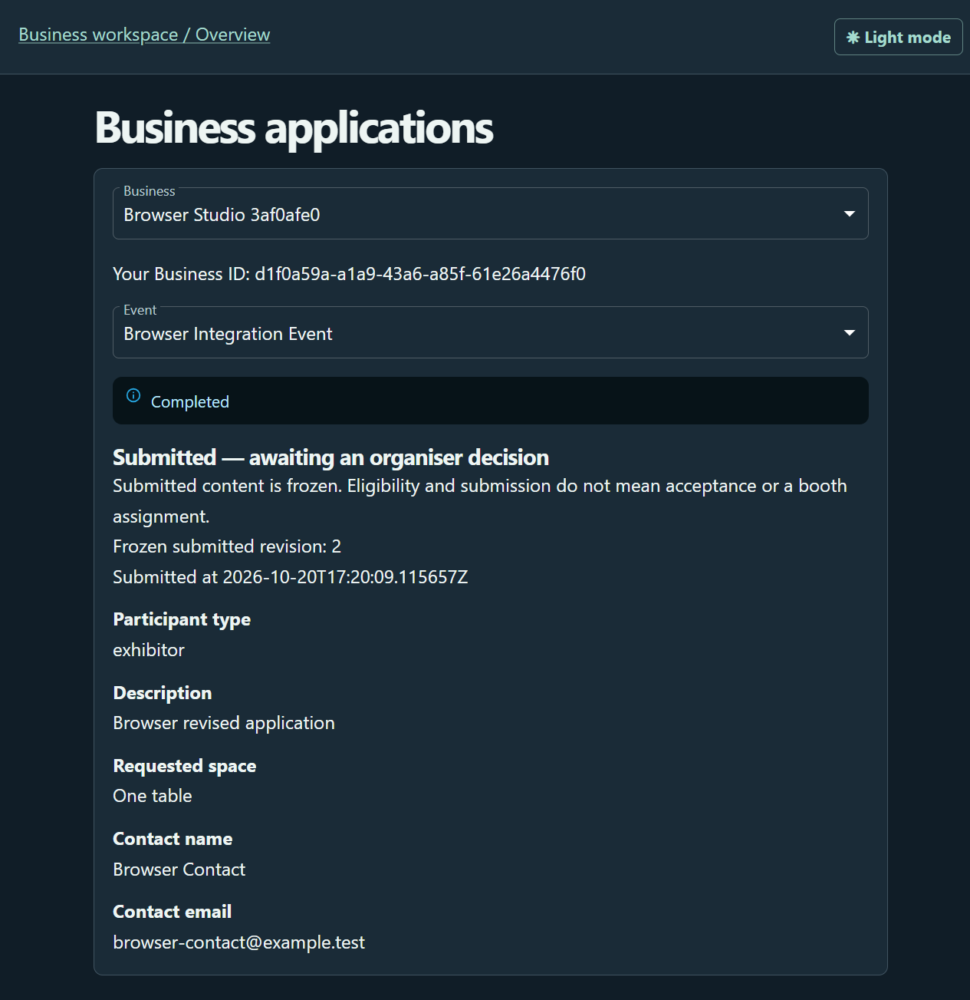
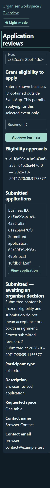
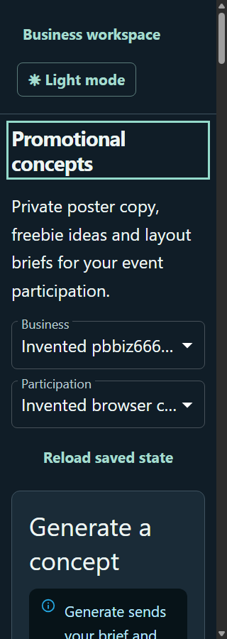
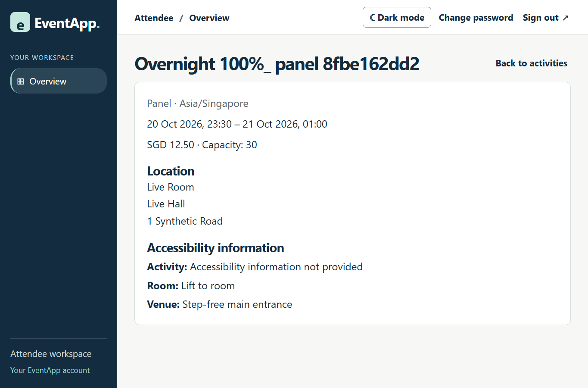

# EventApp user guide

Start with the [three-role smoke walkthrough](#three-role-smoke-walkthrough) for a demonstration, or use the feature reference below it. **Organizer** is labelled **Organiser** in EventApp's interface. Local setup and operator commands are in the [developer guide](DeveloperGuide.md#run-locally); earlier stage-specific testing guides are in the [archive](archive/README.md).

## Known AI limitation

Irrelevant or out-of-scope inputs to EventApp's LLM-assisted features may return unexpected, inaccurate or unrelated values. Guardrails may miss certain situations and do not guarantee that every response is relevant or correct. Keep requests focused on the feature's purpose, check generated results against the published programme or other source evidence, and review AI suggestions before saving, accepting or using them. If a result is unexpected, rephrase the request or use the manual workflow.

## Three-role smoke walkthrough

This walkthrough connects Organizer, Business and Attendee actions in one example event. Allow about 45-60 minutes plus first-time installation. Each **Expect** statement is a check to perform, not a claim that this session executed it. AI wording and supplier results vary.

### 0. Prepare the demo

Have the operator complete [local setup](DeveloperGuide.md#run-locally), [event/account provisioning](DeveloperGuide.md#provision-an-organiser-for-manual-testing) and [three-role AI configuration](DeveloperGuide.md#configure-ai-for-the-three-role-demo). Manual steps need the API, database and frontend. The three LLM demonstrations also need a working SoCLaaS key/model, event allowlisting and a running worker; supplier research additionally needs Tavily. Use only the invented examples below. No payment card or real supplier recipient is needed for sandbox proposals.

Use the URL printed by Vite, normally `http://localhost:5173`. Keep three independent sessions: a normal browser window for Organizer, a private window for Business, and another browser or separate browser profile for Attendee. Two private windows in the same browser share a login.

| Item | Copyable value |
| --- | --- |
| Event | `Singapore Makers Weekend 2027` |
| Timezone and dates | `Asia/Singapore`, 6 March 2027 10:00 to 7 March 2027 18:00 |
| Organizer username | `smoke-organiser` |
| Organizer initial password to choose at CLI prompts | `SmokeOrganiser-Init-2027` |
| Organizer replacement password | `SmokeOrganiser-Live-2027` |
| Business display name / username | `Priya Raman` / `kopi-and-clay` |
| Business email / business name | `priya@kopi-and-clay.example.test` / `Kopi & Clay Studio` |
| Business password | `KopiClay-Smoke-2027` |
| Attendee display name / username | `Alex Tan` / `makers-attendee` |
| Attendee email / password | `alex@makers.example.test` / `Makers-Attendee-2027` |

These passwords are public demo examples for a local synthetic environment. On repeat runs, reuse existing accounts and their changed passwords, or choose fresh unique usernames, emails and business names. Preserve retained development data.

### 1. Organizer: publish a programme and open applications

1. Choose **Organiser**, log in as `smoke-organiser` with the initial password, then change it to the replacement above when prompted. On a repeat run use the replacement directly.
2. Open **Programme Management**, select **Singapore Makers Weekend 2027**, and create this venue and room:

| Field | Value |
| --- | --- |
| Venue name | `Makers Hall` |
| Venue address | `1 Example Lane, Singapore` |
| Venue accessibility details | `Step-free main entrance` |
| Room name | `Studio A` |
| Room capacity | `30` |
| Room accessibility details | `Ground-floor room with step-free access` |

3. Choose **New item**. Enter each row below as a separate activity, with room **Studio A**, capacity `30`, and accessibility details `Step-free access and seated participation`. Dates and times are in the displayed event timezone. Use the calendar/time controls, then **Save draft**, **Validate**, **Publish**, **Confirm publish** for each item.

| Title | Type | Starts at | Ends at | Price (SGD) |
| --- | --- | --- | --- | --- |
| `Clay Cup Workshop` | Workshop | 6 Mar 2027 10:30 | 6 Mar 2027 11:30 | `12.50` |
| `Coffee Tasting` | Workshop | 6 Mar 2027 12:00 | 6 Mar 2027 12:30 | `0` |

**Expect:** both activities show Published. Saving/validating alone leaves an activity private. Publication uses the saved revision.

4. Return home, open **Application Reviews**, select the same event, enable **Accepting applications**, then **Save application settings** and **Confirm settings**.

**Expect:** the event becomes available in Business open applications. Leave the Organizer session open.

### 2. Business: register and submit an application

1. In the Business session choose **Business** -> **Create account**. Paste Priya's account values from step 0 and confirm the password. Existing users log in instead.
2. Choose **Open applications** and the example event. Confirm your own contact details prefill, then enter:

| Field | Value |
| --- | --- |
| Participant type | Vendor |
| Description | `Handmade stoneware cups and a pour-over coffee tasting corner.` |
| Requested space | `3m x 3m booth near a power point` |

3. **Save draft**, reload and verify the text remains. Choose **Review submission** -> **Submit application**.

**Expect:** Submitted, awaiting an organizer decision; submitted text is read-only. Submission is not acceptance or a booth booking.



*Earlier browser capture recorded with the 21 October application work. Its synthetic account/event values and layout differ from this demo; it illustrates the submitted read-only state.*

### 3. Organizer LLM: analyse an application, then decide

1. In the Organizer session open the submitted Kopi & Clay application in **Application Reviews**, then its AI analysis view (also reachable from **AI Application Analysis**).
2. Keep the starter criterion IDs; for the first criterion set title `Event relevance` and paste these instructions:

```text
Check whether the proposal describes a pottery or coffee activity relevant to a makers event. Quote only the submitted description. State insufficient evidence for claims the application does not support.
```

3. Choose **Save rubric**, then **Analyse application**. Read the disclosure and choose **Start analysis**. Observe pending/running and the final result. If unavailable, check [AI troubleshooting](DeveloperGuide.md#ai-troubleshooting); continue manual review without presenting a failed run as an LLM pass.
4. Review criterion findings, exact evidence quotes, source/rubric revisions and any bounded text-match warnings. **Expect:** the AI report has not accepted or rejected the application. Interpretation remains your responsibility.
5. Choose **Continue manual review**, **Approve application**, **Confirm approval**. Enter booth label `Hall B - Booth 12` and the setup instructions below, then **Save setup**:

```text
Load in from 8:00 to 9:30 via Gate 3. One 13A power socket and a 1.8m table are provided.
```

6. Reload the application in the Business session. **Expect:** Accepted, with the private setup draft still hidden. Back in Organizer choose **Publish setup** and confirm; reload Business again. **Expect:** booth and instructions are now visible.

<details>
<summary>Historical Organizer review screenshot</summary>



This capture was recorded with the 21 October application work. Its old **Grant eligibility to apply** section has been superseded by open-event application settings; follow the instructions above, not that historical control. It illustrates Organizer-only access to submitted details, not the current AI report screen.

</details>

### 4. Business: preparation, budget and an LLM draft

1. Home -> **Open preparation** -> choose the example participation. Add tasks `Glaze and pack 120 cups` and `Print price cards`; mark the first done.
2. Set **Spending limit (SGD)** to `100`. Add a cost item: description `Kraft paper bags`, category Packaging, quantity `3`, unit price `1.23`. Choose **Save preparation** and reload.

**Expect:** saved tasks, estimated spend SGD 3.69, remaining budget SGD 96.31.

3. Home -> **Open AI preparation draft** -> choose the business/event/participation. Paste into **Needs**:

```text
Suggest two display tasks and two material estimates for a pottery and coffee booth; no suppliers or external actions.
```

4. Select only `Print price cards` as task context; inspect the published booth facts and sharing disclosure, then **Generate preparation draft**. The page checks status automatically. **Expect:** a private draft with suggested tasks and estimate/unknown costs, or an actionable failure leaving manual preparation unchanged.
5. Rename one suggested task `Set up cup display shelves`, choose **Save draft**, then reload. Check the edit persists and manual preparation is unchanged.
6. Select that task and one suggested cost, choose **Adopt selected items**, then **Confirm adoption**. **Expect:** selected items append to Preparation & Budget. Repeat adoption and check no duplicates appear. Never treat estimates as supplier quotations.

### 5. Business: promotional concepts, supplier shortlist and sandbox proposal

1. **Open promotional concepts** -> choose the participation. Brief:

```text
Playful poster and freebie ideas for handmade cups and free coffee tastings.
```

Select the event title/start time and published booth label; review the disclosure and **Generate concepts**. Review poster copy, freebies and layout suggestions separately from authoritative facts. Edit a poster line to `Sip, hold, take home: Kopi & Clay at Booth 12`, **Save draft**, reload and verify it persists. These suggestions remain unverified after editing.



*Existing synthetic browser capture from the F09 work; this shows the concept entry screen, not evidence of a completed generation in this run.*

2. **Open supplier research** -> choose the participation; category Printing, quantity `100`, delivery area `Central Singapore`, needed-by date blank. Brief:

```text
A6 price cards on 300gsm matte card, single-sided
```

Review the Tavily/AI disclosure, then **Research suppliers**. **Expect:** sourced offers or an actionable failure. Check source links, retrieval dates, field quotes and unknown prices/delivery. Results vary with live sources. Partial research can still contain saveable offers; if none are usable, record that outcome and skip procurement.
3. Tick an offer, **Save selected offers** (or **Save shortlist**), reload and check it persists. Choose **Procurement proposals from this shortlist**, **Quotation request**, and the saved entry. Use recipient `sales@print-shop.example.test` and request:

```text
Please quote 100 A6 price cards, 300gsm matte, delivery before 1 Mar 2027.
```

4. **Create proposal** -> **Open proposal** -> **Approve proposal** and confirm -> **Simulate approved proposal**. **Expect:** an approval expiry and explicitly simulated sandbox receipt. No email, order or payment is sent. Revising a proposal invalidates its earlier approval; cancellation makes it final.

### 6. Attendee: browse, bookmark and accept a manual plan

1. In the independent Attendee session choose **Attendee** -> **Create account** using Alex's values in step 0 (or log in).
2. **Explore programme** -> **Singapore Makers Weekend 2027**. Search `Clay`, filter Workshop and 6 Mar 2027, then open **Clay Cup Workshop**.

**Expect:** 10:30-11:30 Asia/Singapore, SGD 12.50, capacity 30, Makers Hall / Studio A, and the accessibility notes entered earlier. Capacity is declared capacity, not remaining places. Clear filters to see both activities.



*Existing browser capture from the 21 October attendee integration work. The activity/event values are from that earlier synthetic run; the fields illustrate what to check above.*

3. Home -> **My Itinerary** -> **Open My Itinerary** -> choose the example event. Set **Interests** to `Pottery and coffee`, **Budget (SGD)** `20`, **Minimum gap (minutes)** `15`, leave Accessibility needs empty for this first pass, then **Save preferences**.
4. **Bookmark** Clay Cup Workshop, **Add to draft** both activities, then **Save draft**. **Expect:** no overlap, total SGD 12.50 and a valid draft. Choose **Accept itinerary**; reload and inspect **Accepted versions**. The saved version should persist. No ticket purchase or place reservation occurs.

### 7. Attendee LLM: itinerary suggestions and event questions

1. In planning choose **Generate AI itinerary** after reviewing the external-service notice. Observe status, then inspect proposed activities, reasons, cited revisions and constraint checks. **Expect:** only current published activities and no automatic change to the accepted version. The model may return infeasible; record that result and retain the manual plan.
2. For a feasible current result choose **Save as draft**, review it, then explicitly **Accept itinerary** if wanted. Check the previously accepted version remains in history. A stale suggestion cannot be saved as current; generate again after programme/preference changes.
3. In the event programme view find **Ask about this event**, paste the following into **Your question**, then **Ask question**:

```text
When does Clay Cup Workshop start, where is it, and how much does it cost?
```

**Expect:** verified facts point to Clay Cup Workshop's current revision and show 10:30 on 6 March, Studio A / Makers Hall and SGD 12.50 when those fields are answered. An explicit unknown is valid if the service cannot ground the answer. Any AI summary is separate and can be wrong; compare it with the verified facts.

4. Ask `Will it rain during this event?`. **Expect:** an unknown/outside-programme response rather than invented weather information. Browsing and accepted plans remain available.

### 8. Organizer changes and final checks

1. Organizer -> **Programme Management** -> Coffee Tasting -> **Edit published activity**. Change its start/end to 12:15/12:45 on 6 March, **Review published changes**, then **Confirm changes**.
2. Open that activity's change history/announcements, create a manual announcement draft and save:

```text
Coffee Tasting now runs from 12:15 to 12:45 on 6 March in Studio A. Please review your itinerary before attending.
```

Preview the exact text, then **Approve and publish**. **Expect:** Attendee **Event announcements** shows the published notice; an accepted itinerary is not silently replaced. In planning, compare accepted and current details and review any attention warning. Private notification delivery depends on the configured integration; an unavailable inbox is not proof of delivery.
3. In each role reload to check saved records, toggle appearance and sign out. Reopening a private workspace should require sign-in. Optionally register a second Business with different unique account/business details and confirm it cannot see Kopi & Clay's records.

Record manual pass/fail/not-run per step, AI job IDs and provider outcome without credentials. A complete three-role LLM demonstration needs successful Organizer analysis, Business draft and Attendee generation/question results; safe failures establish fallback behavior only. Earlier screenshots and automated mock-provider tests do not establish a new live-provider pass.

---


## Create an account

Choose **Attendee** or **Business** on the login page, then select **Create account**. Enter your display name, username, email and an 8–128-character password. Business registration also asks for a new business name and creates you as its initial owner. Confirm your password and submit; successful registration opens your workspace.

Each email and username can belong to only one account across all three roles. Business names must be unique. Registration cannot join an existing business or create an organiser.

## Log in and sign out

Choose your account's role tab and enter its username or email and password. Incorrect credentials or the wrong role show the same generic error. Refreshing the page restores your valid session; sessions expire after seven days. Use **Sign out** to revoke the current session on the server. If the server is unavailable, retry rather than assuming you have signed out.

Organiser accounts are created by the team through the bootstrap command described in the [developer guide](DeveloperGuide.md#provision-an-organiser-for-manual-testing). An organiser must replace the initial password before opening their workspace and needs an active assignment to an event. A business account needs its active owner membership. Contact the team if your workspace reports no active membership.

## Change your password and appearance

Use **Change password** in your workspace and provide your current password, new password and confirmation. Successful replacement signs out your other sessions and replaces the current session token. Password recovery and email verification are not available in this first slice.

The appearance control switches between light and dark themes. Your explicit choice is saved on the current browser; otherwise EventApp follows the operating system preference.

## Current feature availability

Account registration, login, session restoration, password changes and logout use the backend. Organiser programme management and business application submission/review/decisions are available. Organiser AI application analysis is available for explicitly configured invented-data events. Authenticated attendees can use Explore programme to browse published activities and request synthetic-data AI itinerary suggestions. Business preparation offers a manual checklist, overall spending limit and optional cost breakdowns. AI preparation provides private editable suggestions with selected append-only adoption when configured; promotional concepts, supplier research and procurement proposals are described below.

## Organiser AI application analysis

Open **AI Application Analysis** or **Application Reviews**, select an assigned event and open a submitted application. Edit and save the event's assessment criteria before starting analysis. Each save creates an immutable rubric revision; a conflict preserves your unsaved edits until you choose to reload.

Choose **Analyse application**, review the data-sharing disclosure, and choose **Start analysis**. A background worker processes the job. Follow pending/running status, cancel if needed, or continue manual review. Cancellation after dispatch may still use provider quota; later output is discarded. Refresh restores the latest owned job.

Reports show criterion findings, exact evidence quotes, source/rubric revisions and bounded possible text matches. Their interpretation requires your judgment. Saving a newer rubric marks old reports stale; **View criteria used** shows the saved version behind a report. Analysis never records an application decision. Reports remain private to their requesting organiser with current event access.

Live analysis requires local SoCLaaS setup and a dedicated allowlisted event containing invented descriptions and assessment instructions. Production analysis is disabled. The [AI testing guide](archive/AIAnalysisTesting.md) explains setup and limits; when AI is unavailable, use the existing manual decision controls.

## Organiser programme management

Open **Programme Management** and select an assigned event. Create a venue with its address, add a room and capacity, then create a complete programme draft. Use the calendar/time controls in the displayed event timezone, choose a room/type and set capacity and a price in SGD dollars (for example, `12.50`). Prices allow zero and at most two decimal places; the backend still stores integer cents. Blank accessibility notes mean unknown. Activities may overlap in one room; each item's capacity must still fit that room.

Save the draft before validating or publishing. **Validate** checks the saved revision without publishing. **Publish** requires confirmation and makes the stored revision visible to authenticated attendees. Published items require the separate change workflow below; their venues/rooms remain locked against editing. Drafts and unused locations can be deleted after confirmation; referenced locations cannot.

If another tab saves first, reload and review its revision before retrying. Publication never silently includes unsaved edits. Detailed walkthroughs and API handoff are in [programme testing](archive/ProgrammeTesting.md).

Venue/room pencil icons open editing; trash icons open deletion confirmation. A room cannot be deleted while any activity references it, and a venue cannot be deleted while it has rooms. For an activity, select its title and use **Delete** in its saved draft details. Published and cancelled activities cannot be hard-deleted.

### Published changes and announcements

Select a published activity, choose **Edit published activity**, review the before/after preview and explicitly confirm. Each change preserves its previous public facts. **Cancel activity** requires a reason and confirmation; cancellation is final. Cancelled activities remain visible, with their reason, and cannot be edited or restored. Existing accepted plans are never silently replaced.

Change history separates verified facts from announcement wording. Create a private manual draft for the latest change, save it, then preview its exact text before **Approve and publish**. A preview expires after 15 minutes; changing the draft or activity requires a new preview. Published announcements are immutable and readable by signed-in attendees for the event. Only one announcement can be published for a change.

AI assistance is optional and available only for configured invented-data events. Review the data-sharing disclosure, start a drafting job and review the resulting private wording. AI never publishes. Manual authoring remains available if AI fails. If a write outcome is uncertain, check current state before retrying.

Attendees can open **Event announcements** from the programme and **Notifications** for their private inbox. Accepted-itinerary delivery is explicitly pending the teammate-owned F02 integration; until then the inbox shows an unavailable/pending message, not a successful empty recipient result. See [F05 testing](archive/DisruptionsTesting.md).

## Attendee programme browsing

Sign in as an attendee and choose **Explore programme** in Browse Programme. The frontend has event/activity lists, title/type/date filters, pagination and activity details including event-local times, SGD/free pricing, declared capacity and separate accessibility notes. Missing notes mean unknown; capacity is not remaining inventory. The screen uses the published programme API. Date filters match the activity’s start date in the event timezone, including activities ending the following day; all six types, including Panel, are supported. Retry and session-expiry handling are present. Only published activities appear; this journey does not reserve capacity or buy tickets.

### Attendee AI itinerary suggestions

After selecting an event in attendee planning, set your preferences. The page notes that your preferences and the programme are sent to an external AI service; do not enter personal details. Choose **Generate AI itinerary** to request a background suggestion. The request can be cancelled, is subject to the daily limit, and reports pending, running, completed, failed or cancelled status. A completed result shows the proposed activities, reasons, sources and constraint checks.

AI output is only a suggestion: it is not saved or accepted automatically. Review every activity, especially missing accessibility information, then choose **Save as draft** if the result is still current. If preferences or published programme revisions changed, the result is marked stale and must not be saved; use manual planning or generate a fresh result. Provider failure, unavailable event configuration and infeasible constraints leave the existing planning state unchanged.

### Attendee event questions

On an event's programme page, use **Ask about this event** to type a question (up to 300 characters) and choose **Ask question**. The page notes that your question is sent to an external AI service; do not enter personal details. The answer is prepared in the background (up to a minute) and can be cancelled. A completed answer lists verified facts, each with the activity title, revision, value taken from the programme and a link to the activity; cancelled activities are marked **Cancelled**. An **AI summary** sentence appears only when it passes the server checks, and only the verified facts are checked against the programme. If the programme cannot answer, or its information conflicts, you see an explicit unknown message with a link to browse the programme. If the programme changed after the answer was prepared, no answer is shown and you can choose **Ask again**. Each question is independent, there is a daily limit, and failures never change the programme or your plans. Live answers work only for events the operator has configured with invented data; production is disabled.

## Business preparation

New application contacts default to your account name/email and remain editable. Dates display in the event region with 24-hour times. Organisers Save setup privately, then explicitly Publish setup when ready; businesses see only published details. Preparation provides compact tasks, an overall spending limit and optional categorized cost items, with exact estimates/remaining budget. Back to AI preparation returns to your current context. Each source-context checkbox selects only that item for AI sharing; Generate shares the displayed selected fields under the provider disclosure. There is no invented-data pledge. Configuration and provider availability are still required; generation never replaces manual data automatically. See [the testing walkthrough](archive/BusinessPreparationTesting.md) for local setup and checks, or the end-to-end [Business smoke test](archive/BusinessSmokeTest.md) for a follow-along of every Business feature.
## Promotional concepts

From the Business workspace, open **Promotional concepts** and select an existing participation. Add a creative brief and select the event or published setup facts you want to share with the AI provider. **Generate concepts** requests a separate private draft; use **Refresh status** or **Cancel job** while it runs.

Poster copy, freebie concepts and layout notes remain unverified suggestions, including after editing. Check every claim before using it. Authoritative facts appear separately with source freshness. Save edits, reopen older drafts, refresh selected facts explicitly, or delete a saved draft. Drafts belong to their creator and persist until deletion; provider copies are outside local deletion. No publishing, messages, purchases or payments occur. See [the promotional guide](archive/PromotionalConceptsTesting.md) for configuration and verification limits.

## Supplier research

Open **Supplier research** in the Business workspace. Choose an existing participation, category, brief, quantity and coarse Singapore delivery area, then review the Tavily/AI sharing disclosure before researching. Inspect source evidence, retrieval times, unknowns and estimated item subtotals. When **Partial research: some sources could not be used.** appears, you can still save the available offers, including listings with unknown price or delivery. Tick the offers you want, then choose **Save selected offers** beneath the offers or **Save shortlist** above the comparisons. Both buttons save all current shortlist selections for this participation; reload to confirm they persist. Comparisons and selections are private to their creator. Researching again creates separate evidence. Clear and save selections before deleting a referenced comparison. No email, order or payment occurs. See [the supplier guide](archive/SupplierResearchTesting.md) for limits and recovery steps.
